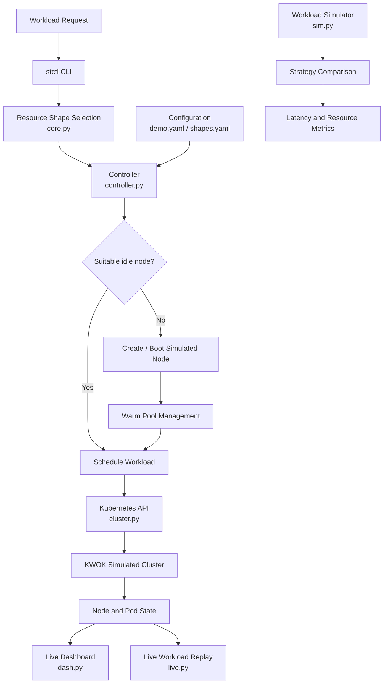

# Netflix VM Isolation

A Kubernetes-based compute orchestration prototype that explores resource-aware workload placement, pre-warmed compute capacity, and single-tenant node scheduling.

The project models how workloads with different CPU and memory requirements can be assigned to appropriately sized compute nodes while reducing startup latency through a warm-node pool.

> **Implementation note:** This project currently uses KWOK (Kubernetes WithOut Kubelet) to simulate Kubernetes nodes. It demonstrates orchestration and scheduling behaviour, not actual virtual machine provisioning or hypervisor-level isolation.

## Architecture

## Key Features

- **Resource-aware placement:** Selects the smallest available compute shape that satisfies a workload's CPU and memory requirements.
- **Warm-node pool:** Maintains pre-warmed capacity to reduce workload startup delays.
- **Single-tenant scheduling:** Uses Kubernetes scheduling constraints and pod anti-affinity to prevent workloads carrying the configured tenancy label from sharing a node.
- **Reconciliation controller:** Continuously monitors cluster state and manages idle, busy, pending, and booting nodes.
- **Workload simulation:** Compares cold-start, fixed warm-pool, and adaptive warm-pool strategies.
- **Live workload replay:** Submits synthetic workloads to a running Kubernetes environment and records startup latency.
- **Dashboard:** Displays node utilisation, workload state, and warm/cold scheduling information.

## System Components

| Component | Responsibility |
|---|---|
| `stctl/core.py` | Compute shape selection and resource calculations |
| `stctl/controller.py` | Node reconciliation and warm-pool management |
| `stctl/cluster.py` | Kubernetes node and pod object definitions |
| `stctl/sim.py` | Discrete-event workload and warm-pool simulation |
| `stctl/live.py` | Workload replay and startup-latency measurement |
| `stctl/dash.py` | Lightweight HTTP dashboard server |
| `stctl/cli.py` | Command-line interface |
| `config/` | Workload and compute-shape configuration |
| `manifests/` | Kubernetes scheduling resources |
| `scripts/` | Environment checks and cluster lifecycle scripts |
| `tests/` | Core logic and simulation tests |

## Compute Shapes

The prototype defines five compute shapes:

| Shape | CPU | Memory |
|---|---:|---:|
| s4 | 4 vCPU | 16 GiB |
| s8 | 8 vCPU | 32 GiB |
| s16 | 16 vCPU | 64 GiB |
| s32 | 32 v
